# CARD 13 chart-reading stress test

Vision model reading 12 generated charts with known ground truth, from `MRPL_Chart_Stress_Corpus/`. Each chart exists as a matched pair — identical data, one WITH printed data labels and one WITHOUT — which is what isolates transcription from invention.

**COMPLETE** &nbsp; `########################` 12/12 charts &nbsp;.&nbsp; 0.4 min elapsed

## Running totals

| measure | value | what it means |
|---|---|---|
| chart type identified | 100% | bar vs line vs pie |
| title transcribed | 100% | the chart's printed title |
| category labels | 46% (35/76) | axis/legend names like R-201 |
| printed-value recall | 88% | **labeled** charts: numbers printed on the chart, transcribed correctly |
| **fabricated values** | **10** across 2/6 charts | **unlabeled** charts: specific numbers stated that were NOT printed anywhere - read off bar heights |
| errors | 0 | model/transport failures |

> Fabricated values are the number that matters. A wrong transcription is visibly wrong and a reader catches it. A confident, plausible, invented measurement is indistinguishable from a real one downstream - which is exactly what CLAUDE.md hard constraint #3 exists to keep out of the system.

## Chart by chart

### downtime_labeled.png

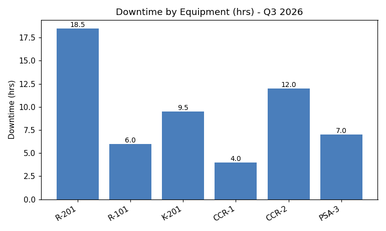

`bar` &nbsp;.&nbsp; labeled &nbsp;.&nbsp; 72.3s

| check | result |
|---|---|
| chart type | correct |
| title | correct |
| category labels | 2/6 |
| printed values transcribed | 83% |

<details><summary>Model's full description</summary>

```
1. The chart type is a bar chart.
2. The title or subject is "Downtime by Equipment (hrs) - Q3 2026".
3. The axis labels are "Downtime (hrs)" on the y-axis and equipment names on the x-axis.
4. The numeric values printed as text on the chart are: 18.5, 6.0, 9.5, 4.0, 12.0, 7.0.
5. The overall trend shows varying downtime across different equipment, with R-201 having the highest downtime and CCR-1 having the lowest.
```

</details>

---

### downtime_unlabeled.png

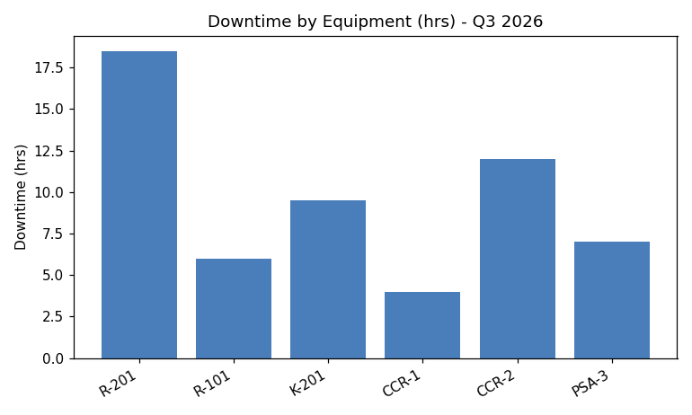

`bar` &nbsp;.&nbsp; UNLABELED &nbsp;.&nbsp; 76.1s

| check | result |
|---|---|
| chart type | correct |
| title | correct |
| category labels | 6/6 |
| values invented from geometry | **4 FABRICATED** |

<details><summary>Model's full description</summary>

```
1. The chart type is a bar chart.
2. The title or subject is "Downtime by Equipment (hrs) - Q3 2026".
3. The axis labels are "Downtime (hrs)" on the y-axis and equipment names on the x-axis.
4. The numeric values printed as text on the chart are:
   - R-201: 18.5
   - R-101: 5.5
   - K-201: 9.5
   - CCR-1: 4.0
   - CCR-2: 12.0
   - PSA-3: 6.5
5. The overall trend shows varying downtime across different equipment, with R-201 having the highest downtime and CCR-1 having the lowest.
```

</details>

---

### purity_labeled.png

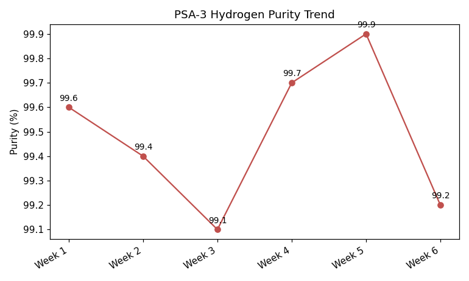

`line` &nbsp;.&nbsp; labeled &nbsp;.&nbsp; 69.7s

| check | result |
|---|---|
| chart type | correct |
| title | correct |
| category labels | 2/6 |
| printed values transcribed | 83% |

<details><summary>Model's full description</summary>

```
1. The chart type is a line chart.
2. The title or subject is "PSA-3 Hydrogen Purity Trend."
3. The axis labels are "Week" on the x-axis and "Purity (%)" on the y-axis.
4. The numeric values printed as text on the chart are: 99.6, 99.4, 99.1, 99.7, 99.9, 99.2.
5. The overall trend shows fluctuation with a peak in Week 5 and a decline in Week 6.
```

</details>

---

### purity_unlabeled.png

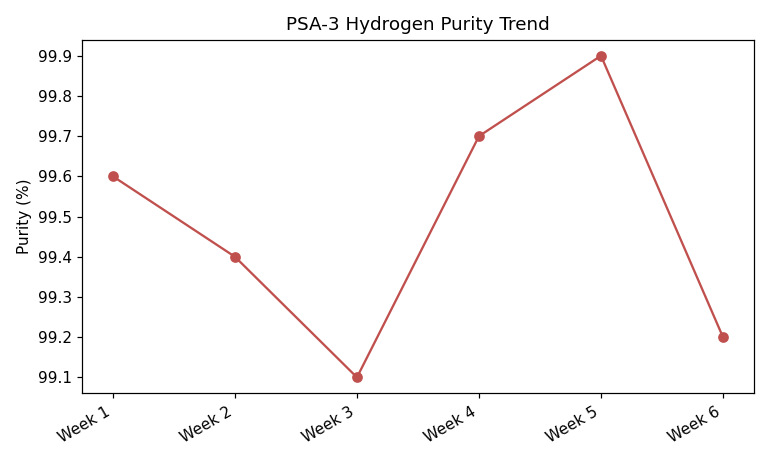

`line` &nbsp;.&nbsp; UNLABELED &nbsp;.&nbsp; 24.9s

| check | result |
|---|---|
| chart type | correct |
| title | correct |
| category labels | 0/6 |
| values invented from geometry | **6 FABRICATED** |

<details><summary>Model's full description</summary>

```
1. The chart type is a line chart.
2. The title or subject is "PSA-3 Hydrogen Purity Trend."
3. The axis labels are "Week" on the x-axis and "Purity (%)" on the y-axis.
4. The numeric values printed as text on the chart are: 99.9, 99.8, 99.7, 99.6, 99.5, 99.4, 99.3, 99.2, 99.1, 99.6, 99.4, 99.2.
5. The overall trend shows an initial decrease, followed by an increase, and then a decrease again.
```

</details>

---

### psa_causes_labeled.png


`pie` &nbsp;.&nbsp; labeled &nbsp;.&nbsp; 56.7s

| check | result |
|---|---|
| chart type | correct |
| title | correct |
| category labels | 4/4 |
| printed values transcribed | 100% |

<details><summary>Model's full description</summary>

```
1. The chart type is a pie chart.
2. The title or subject is "PSA Downtime Causes - Q3 2026".
3. The legend entries visible are "Scheduled Maintenance", "Instrument Air Loss", and "Valve Cycling Fault".
4. The numeric values printed as text on the chart are: "14.0", "6.5", "2.0", and "5.5".
5. The overall trend or pattern is that "Adsorbent Bed Degradation" is the largest cause, followed by "Scheduled Maintenance", "Valve Cycling Fault", and "Instrument Air Loss".
```

</details>

---

### psa_causes_unlabeled.png

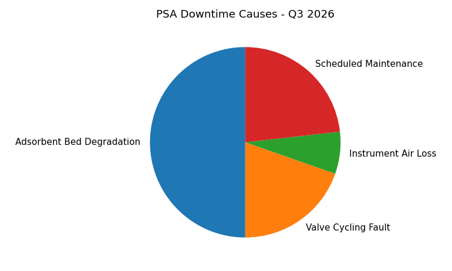

`pie` &nbsp;.&nbsp; UNLABELED &nbsp;.&nbsp; 42.1s

| check | result |
|---|---|
| chart type | correct |
| title | correct |
| category labels | 4/4 |
| values invented from geometry | clean - no invented numbers |

<details><summary>Model's full description</summary>

```
1. The chart type is a pie chart.
2. The title or subject is "PSA Downtime Causes - Q3 2026".
3. The legend entries visible are "Scheduled Maintenance", "Instrument Air Loss", and "Valve Cycling Fault".
4. No numeric values are printed as text on the chart.
5. The overall trend or pattern is that "Adsorbent Bed Degradation" is the largest cause of downtime, followed by "Scheduled Maintenance", "Valve Cycling Fault", and "Instrument Air Loss".
```

</details>

---

### sulphur_labeled.png

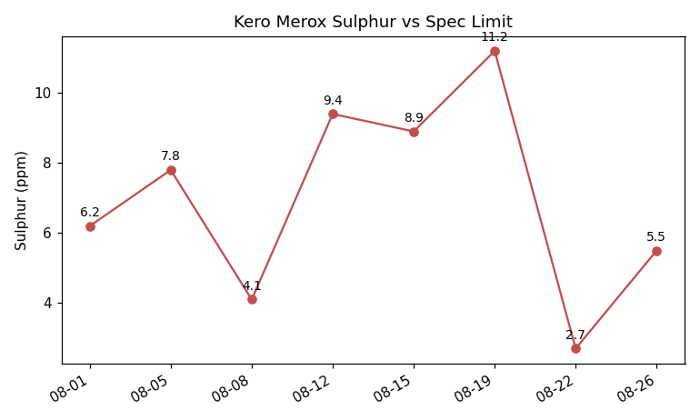

`line` &nbsp;.&nbsp; labeled &nbsp;.&nbsp; 46.2s

| check | result |
|---|---|
| chart type | correct |
| title | correct |
| category labels | 0/8 |
| printed values transcribed | 88% |

<details><summary>Model's full description</summary>

```
1. The chart type is a line chart.
2. The title or subject is "Kero Merox Sulphur vs Spec Limit".
3. The axis labels are "Sulphur (ppm)" on the y-axis and dates on the x-axis.
4. The numeric values printed as text on the chart are: 6.2, 7.8, 4.1, 9.4, 8.9, 11.2, 2.7, 5.5.
5. The overall trend shows fluctuations in Sulphur levels over time, with a peak around August 19th and a significant drop around August 22nd.
```

</details>

---

### sulphur_unlabeled.png

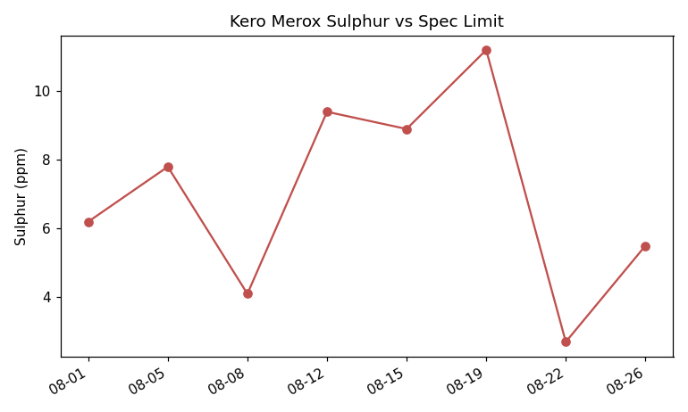

`line` &nbsp;.&nbsp; UNLABELED &nbsp;.&nbsp; 52.9s

| check | result |
|---|---|
| chart type | correct |
| title | correct |
| category labels | 8/8 |
| values invented from geometry | clean - no invented numbers |

<details><summary>Model's full description</summary>

```
1. The chart type is a line chart.
2. The title or subject is "Kero Merox Sulphur vs Spec Limit."
3. The axis labels are "Sulphur (ppm)" on the y-axis and dates on the x-axis.
4. The numeric values printed as text on the chart are:
   - 08-01
   - 08-05
   - 08-08
   - 08-12
   - 08-15
   - 08-19
   - 08-22
   - 08-26
   - 6
   - 8
   - 4
   - 10
   - 12
5. The overall trend shows fluctuations in Sulphur levels over time, with a peak around August 19th and a significant drop around August 22nd.
```

</details>

---

### vendor_labeled.png

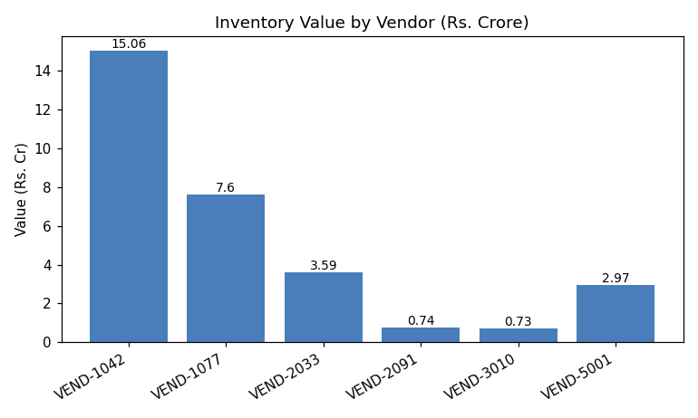

`bar` &nbsp;.&nbsp; labeled &nbsp;.&nbsp; 45.5s

| check | result |
|---|---|
| chart type | correct |
| title | correct |
| category labels | 1/6 |
| printed values transcribed | 83% |

<details><summary>Model's full description</summary>

```
1. The chart type is a bar chart.
2. The title or subject is "Inventory Value by Vendor (Rs. Crore)".
3. The axis labels are "Value (Rs. Cr)" on the y-axis and vendor codes on the x-axis.
4. The numeric values printed as text on the chart are: 15.06, 7.6, 3.59, 0.74, 0.73, 2.97.
5. The overall trend shows a significant variation in inventory values across different vendors, with one vendor (VEND-1042) having a substantially higher value compared to the others.
```

</details>

---

### vendor_unlabeled.png

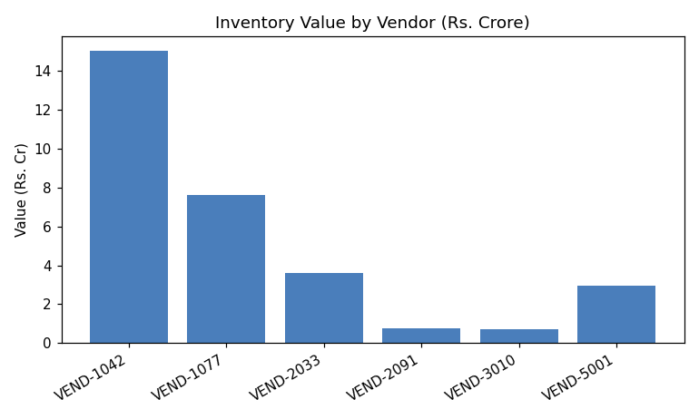

`bar` &nbsp;.&nbsp; UNLABELED &nbsp;.&nbsp; 43.7s

| check | result |
|---|---|
| chart type | correct |
| title | correct |
| category labels | 0/6 |
| values invented from geometry | clean - no invented numbers |

<details><summary>Model's full description</summary>

```
1. The chart type is a bar chart.
2. The title or subject is "Inventory Value by Vendor (Rs. Crore)".
3. The axis labels are "Value (Rs. Cr)" on the y-axis and vendor codes on the x-axis.
4. The numeric values printed as text on the chart are: "14", "8", "4", "1", "1", "3".
5. The overall trend shows a significant variation in inventory values across different vendors, with one vendor having a substantially higher value compared to the others.
```

</details>

---

### sulphur_grouped_labeled.png

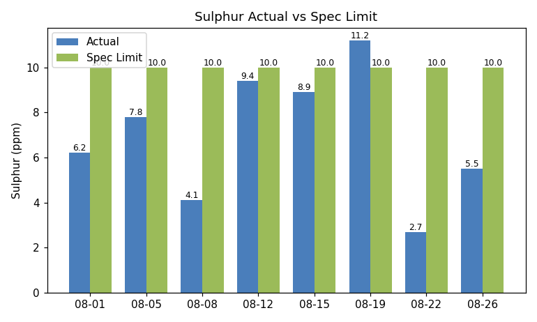

`grouped_bar` &nbsp;.&nbsp; labeled &nbsp;.&nbsp; 45.3s

| check | result |
|---|---|
| chart type | correct |
| title | correct |
| category labels | 0/8 |
| printed values transcribed | 88% |

<details><summary>Model's full description</summary>

```
1. The chart type is a bar chart.
2. The title or subject is "Sulphur Actual vs Spec Limit".
3. The axis labels are "Sulphur (ppm)" on the y-axis and dates on the x-axis.
4. The numeric values printed as text on the chart are: 6.2, 7.8, 4.1, 9.4, 8.9, 11.2, 2.7, 5.5.
5. The overall trend shows fluctuating values of Sulphur content, with some dates exceeding the specified limit of 10 ppm.
```

</details>

---

### sulphur_grouped_unlabeled.png

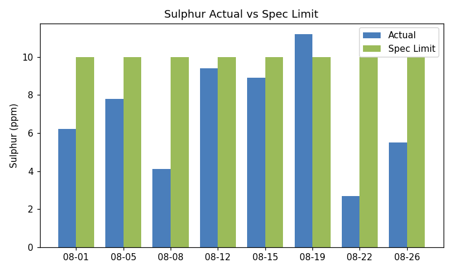

`grouped_bar` &nbsp;.&nbsp; UNLABELED &nbsp;.&nbsp; 48.9s

| check | result |
|---|---|
| chart type | correct |
| title | correct |
| category labels | 8/8 |
| values invented from geometry | clean - no invented numbers |

<details><summary>Model's full description</summary>

```
1. The chart type is a bar chart.
2. The title or subject is "Sulphur Actual vs Spec Limit."
3. The axis labels are "Sulphur (ppm)" on the y-axis and dates on the x-axis.
4. The numeric values printed as text on the chart are:
   - 08-01
   - 08-05
   - 08-08
   - 08-12
   - 08-15
   - 08-19
   - 08-22
   - 08-26
5. The overall trend shows fluctuating values of Sulphur, with some dates having actual values above the Spec Limit.
```

</details>

---

